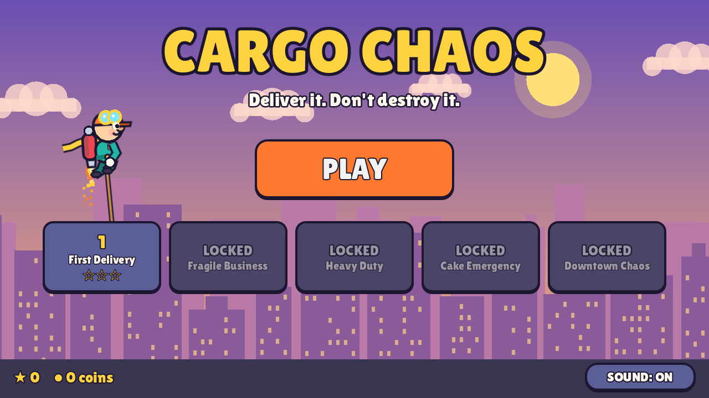
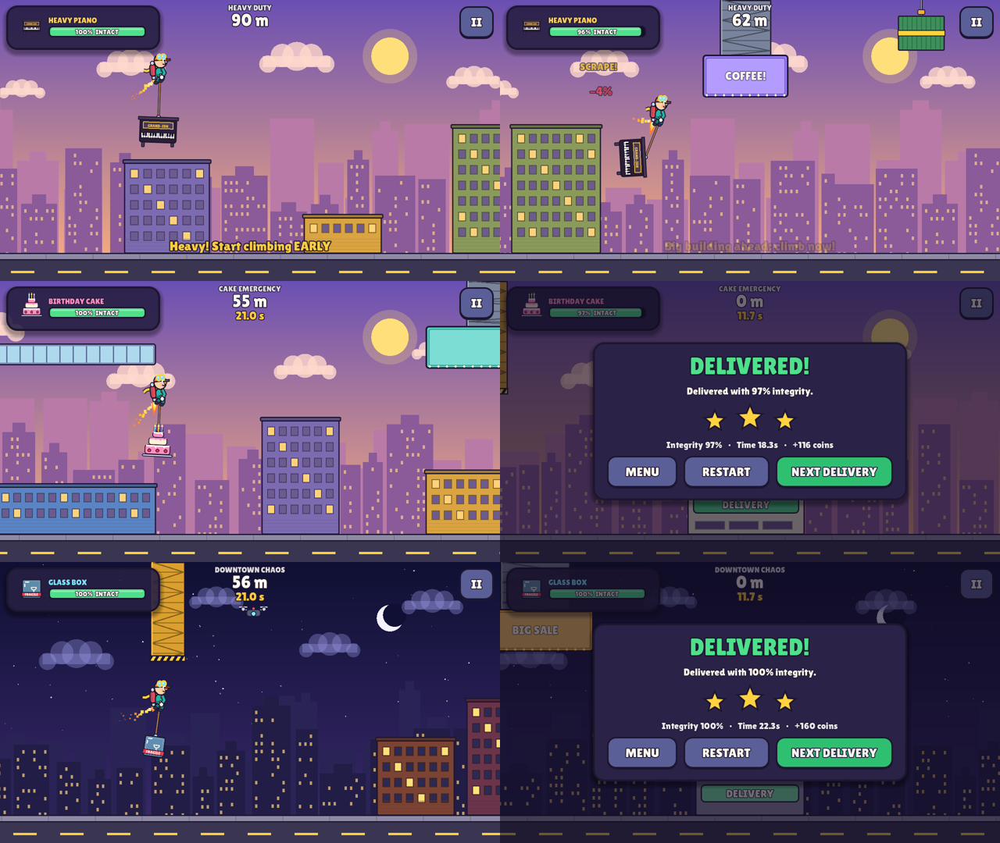
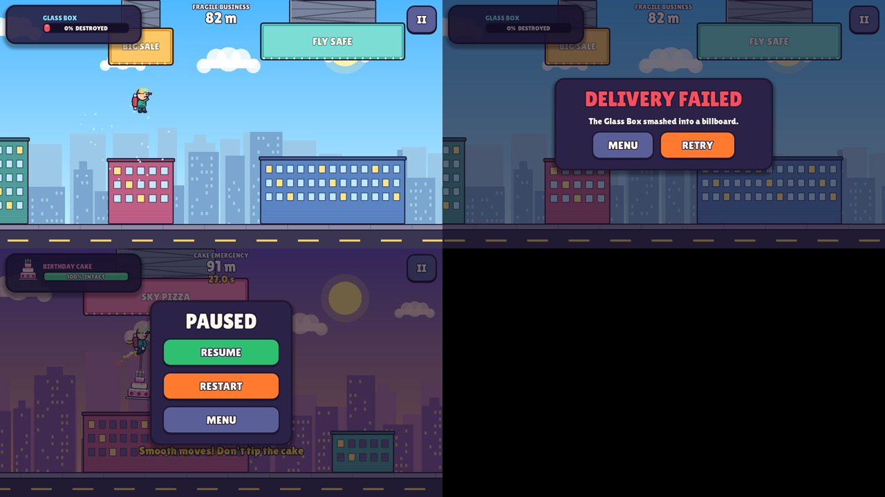

# CARGO CHAOS

*Deliver it. Don't destroy it.*

Arcade físico para móvil (Android/iOS, horizontal) hecho con **Godot 4.7.2** y GDScript. Eres Zippy, un repartidor con jetpack que transporta mercancías colgadas de una cuerda: una caja de cristal que se rompe, un piano que te arrastra, una tarta que no puede inclinarse.



**Estado:** vertical slice jugable de principio a fin (menú → 5 misiones → resultados), 59 pruebas automáticas en verde. Aún no probado por humanos ni en móvil. Ver [PROJECT_STATUS.md](PROJECT_STATUS.md).

## Ejecutar

Requisito: [Godot 4.7.x](https://godotengine.org/download) (versión estándar, no .NET).

```bash
# Desde el editor: Import → cargo-chaos/project.godot → Play (F5)
# Sin abrir el editor:
godot --path cargo-chaos
```

La primera vez que se abre en un proyecto clonado, Godot importa las fuentes y sonidos (si se lanza sin editor, ejecutar antes `godot --headless --path cargo-chaos --import`).

### Controles
| | |
|---|---|
| **Mantener** pantalla / clic izquierdo / Espacio / ↑ / W | Encender el jetpack (subir) |
| Soltar | Descender |
| Esc / P / botón **II** | Pausa |
| R | Reiniciar |

## Pruebas y herramientas

```bash
cd cargo-chaos
tools/run_tests.sh                # compila todos los scripts y ejecuta las 59 pruebas (headless)
tools/overview.sh 0 1 2 3 4       # vista completa de cada nivel con la trayectoria del bot (requiere xvfb-run)
tools/capture.sh --level=2 --times=3,8   # capturas reales de una misión jugada por el bot
tools/capture.sh --menu --times=1
godot --headless --path . --script res://tools/probe_physics.gd   # métricas de tuning de las cargas
python3 tools/gen_audio.py        # regenera los efectos de sonido
```

Las salidas van a `tests/output/` (ignorado por git).

## Crear una misión nueva

1. Copia un fichero de `data/levels/` y edítalo: carga, velocidad, obstáculos (`height` = desde el suelo, `bottom` = colgando del techo, `rect` = libre, `move`/`period` = móvil), plataforma de entrega, pistas y **`autopilot_path`** (ruta de referencia).
2. Añádelo a `data/levels/index.json`.
3. `tools/overview.sh <índice>` para verlo con la trayectoria del bot y `tools/run_tests.sh` para comprobar que es completable.

Toda la física y el daño se ajustan en `data/tuning.json`, `data/cargo_types.json` y `data/obstacle_types.json`.

## Documentación

- [PROJECT_STATUS.md](PROJECT_STATUS.md) — estado real, pendientes, problemas y siguiente prioridad
- [docs/GAME_DESIGN_DOCUMENT.md](docs/GAME_DESIGN_DOCUMENT.md) — diseño (implementado vs. futuro)
- [docs/TECHNICAL_ARCHITECTURE.md](docs/TECHNICAL_ARCHITECTURE.md) — arquitectura y decisiones técnicas
- [docs/TEST_REPORT.md](docs/TEST_REPORT.md) — resultados de pruebas y lo que NO está verificado
- [docs/ASSET_LICENSES.md](docs/ASSET_LICENSES.md) — origen y licencia de cada asset

## Capturas

| | |
|---|---|
|  |  |

Vídeo de la misión 4 completa jugada por el bot: [docs/media/level04_cake_emergency.mp4](docs/media/level04_cake_emergency.mp4)
