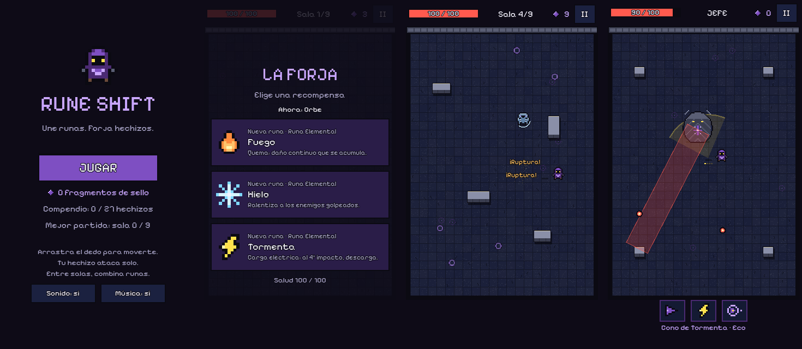

# RUNE SHIFT

Roguelite de acción en pixel art para móvil (vertical). Te mueves con un dedo, tu hechizo ataca solo y, entre salas, forjas el hechizo combinando tres runas: **Forma** (Orbe, Órbita, Cono), **Elemento** (Fuego, Hielo, Tormenta) y **Catalizador** (Eco, Ruptura, Rebote). 27 combinaciones.



**Estado:** primer prototipo jugable: 8 salas + jefe, completo de principio a fin y con 46 pruebas automáticas en verde. Todavía sin pruebas con jugadores. Ver [PROJECT_STATUS.md](PROJECT_STATUS.md).

## Jugar

- **En el navegador / iPhone:** `tools/build_web_page.sh` genera `build/play/` (página autocontenida).
- **Con Godot 4.7.x:** abrir `rune-shift/project.godot` y pulsar F5, o `godot --path rune-shift`.

| Control | |
|---|---|
| Arrastrar el dedo (o clic y arrastrar) | Mover al Forjador; el joystick aparece donde tocas |
| WASD / flechas | Mover (escritorio) |
| Botón II, Esc o P | Pausa |

## Desarrollo

```bash
cd rune-shift
tools/run_tests.sh                       # compilación + pruebas
godot --headless --path . --script res://tools/balance.gd -- --seeds=3   # el bot juega las 27 combinaciones
tools/capture.sh --times=2,8 --form=cone --element=storm --catalyst=echo # capturas reales (xvfb)
tools/capture.sh --room=9 --times=3      # saltar al jefe para capturas
python3 art/sprites_src.py               # regenerar el pixel art tras editarlo
python3 tools/gen_audio.py               # regenerar sonidos (la música se pasa a .ogg con ffmpeg)
```

Todo el contenido y el equilibrio están en `data/`: `runes.json` (valores por nivel), `enemies.json`, `rooms.json` (plantillas, oleadas, curva de dificultad).

## Documentación

- [PROJECT_STATUS.md](PROJECT_STATUS.md): estado, criterios del GDD, limitaciones y siguiente paso
- [docs/TECHNICAL_ARCHITECTURE.md](docs/TECHNICAL_ARCHITECTURE.md): arquitectura y motor de runas
- [docs/TEST_REPORT.md](docs/TEST_REPORT.md): pruebas, equilibrado y lo que no está verificado
- [docs/ASSET_LICENSES.md](docs/ASSET_LICENSES.md): origen y licencia de cada asset
- El GDD V1.0 original es la referencia de diseño; las desviaciones están anotadas en PROJECT_STATUS.
